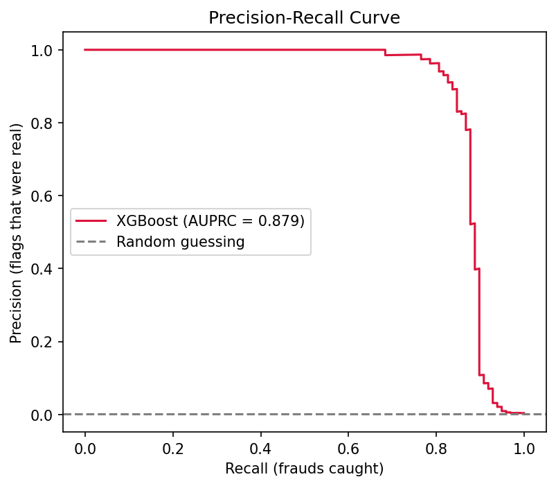
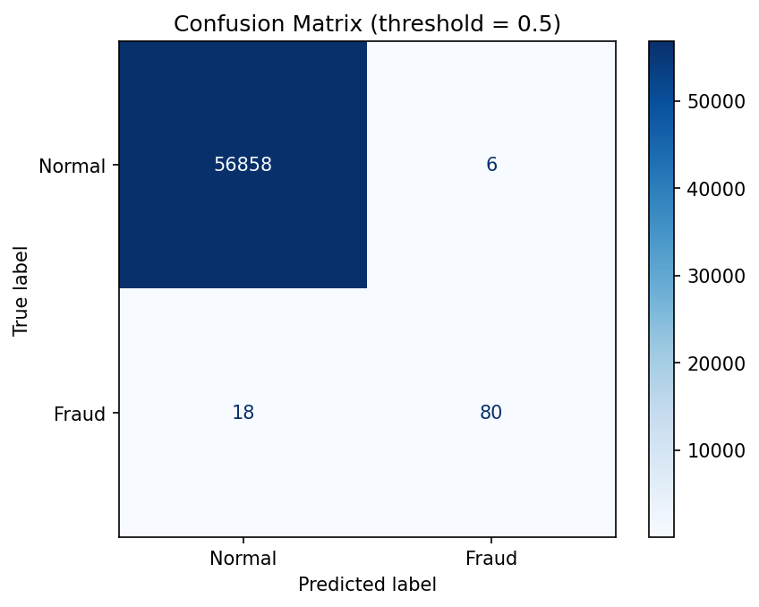
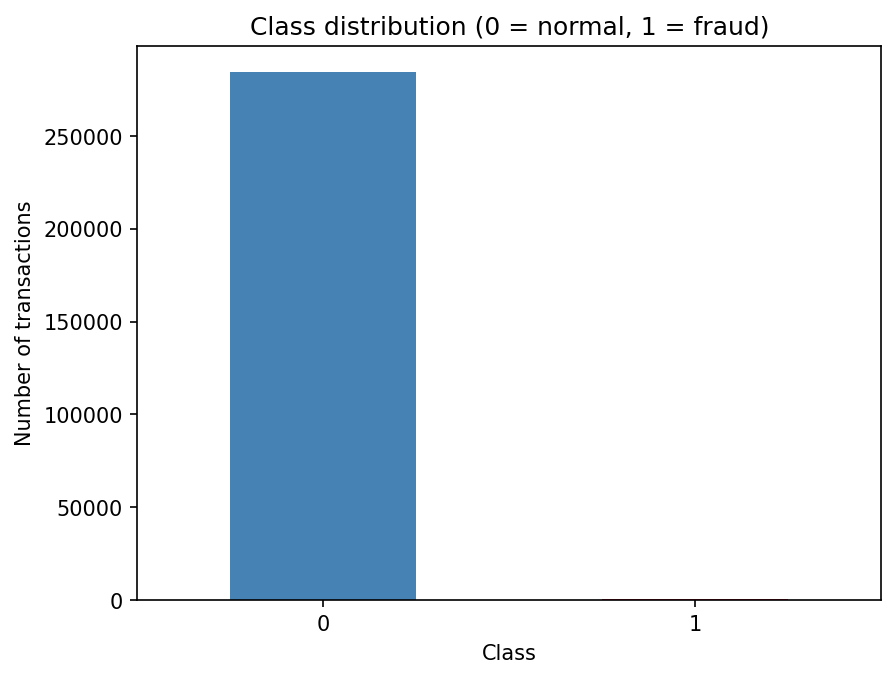
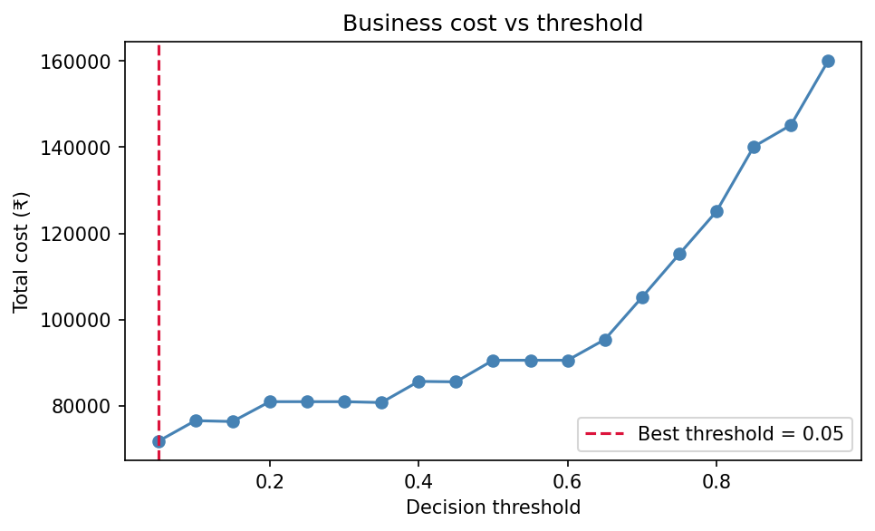
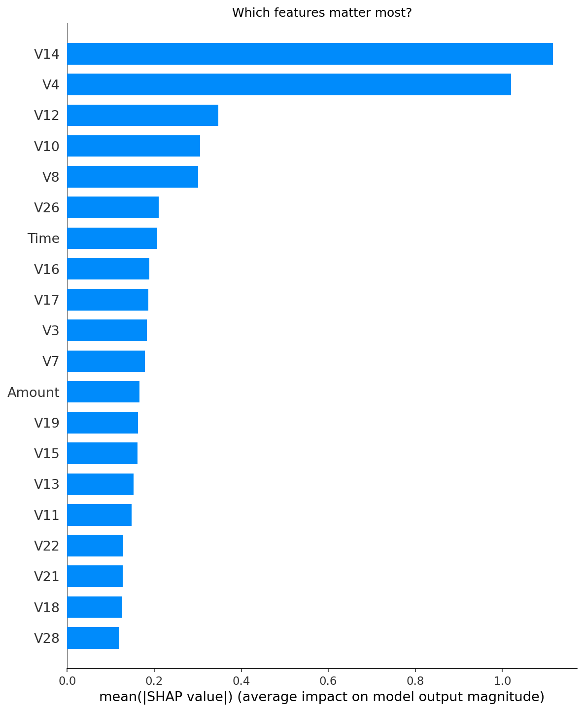
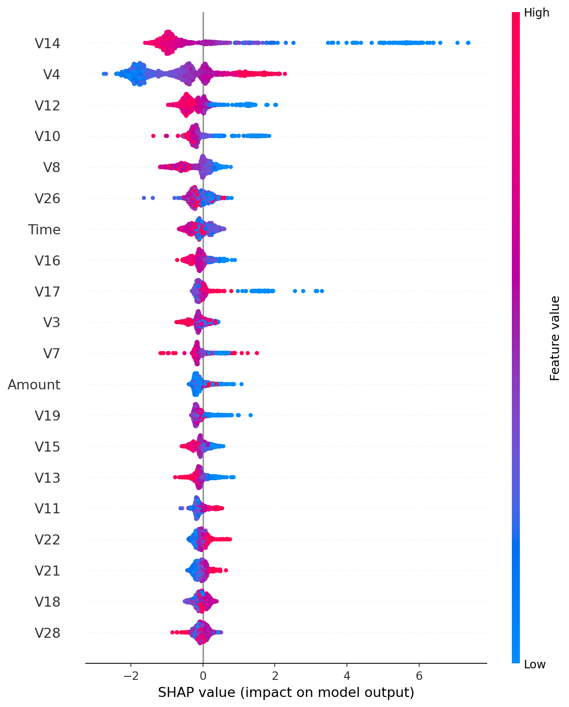

# 💳 Credit Card Fraud Detection

**[🔴 Live demo →](https://credit-card-fraud-detectr.streamlit.app/)**

An end-to-end machine learning project that detects fraudulent credit card transactions on a highly imbalanced dataset (only 0.17% fraud), with model explainability and a deployed web app.

## Results

Evaluated on a held-out test set of 56,962 transactions (98 frauds) that the model never saw:

| Metric | XGBoost (tuned) | Logistic Regression (baseline) |
|---|---|---|
| **AUPRC** | **0.879** | 0.739 |
| Precision | 0.93 | 0.83 |
| Recall | 0.82 | 0.64 |
| F1 | 0.87 | 0.72 |

At the default 0.5 threshold, the model caught **80 of 98 frauds**, missed 18, and raised only 6 false alarms among 56,864 genuine transactions.




## Dataset

[Credit Card Fraud Detection](https://www.kaggle.com/datasets/mlg-ulb/creditcardfraud) from Kaggle: 284,807 transactions made by European cardholders over two days in September 2013, of which 492 are fraudulent (0.172%).

- Features `V1`–`V28` are anonymized PCA components. `Time` and `Amount` are the only original features.
- Because of the extreme imbalance, **accuracy is misleading**. A model that always predicts "not fraud" scores 99.83% accuracy while catching zero frauds. I use **AUPRC** (area under the precision-recall curve), precision and recall instead.



## Approach

1. **EDA:** checked class balance, missing values (none) and amount patterns. Fraud transactions have a lower median amount (9.25 vs 22.00) but a higher mean, which suggests small card-testing purchases plus occasional large ones. `V17`, `V14` and `V12` correlate most strongly with fraud.
2. **Preprocessing:** stratified 80/20 train/test split **before** any other step. `Time` and `Amount` were scaled with `RobustScaler`, fitted on the training set only to avoid data leakage.
3. **Baseline:** Logistic Regression (AUPRC 0.739). A "always not fraud" dummy model got 99.83% accuracy with 0% recall.
4. **Imbalance handling:** tried class weights, SMOTE and undersampling (applied to training data only).
5. **Model comparison:** Random Forest, XGBoost and LightGBM.
6. **Tuning:** `RandomizedSearchCV` over XGBoost parameters with 5-fold stratified cross-validation, optimizing AUPRC (CV AUPRC 0.854).
7. **Evaluation:** precision-recall curve, confusion matrix and a business-cost analysis of the decision threshold.
8. **Explainability:** SHAP values for global and per-transaction explanations.
9. **Deployment:** Streamlit app on Streamlit Community Cloud.

## Key findings

**Resampling changed the trade-off but did not improve ranking quality.** Class weights, SMOTE and undersampling all raised recall from 0.64 to 0.92, but precision fell from 0.83 to about 0.06 (roughly 16 false alarms per real fraud). AUPRC did not improve, so I moved on to stronger models instead.

| Method (Logistic Regression) | Precision | Recall | F1 | AUPRC |
|---|---|---|---|---|
| No fix (baseline) | 0.829 | 0.643 | 0.724 | 0.739 |
| Class weights | 0.061 | 0.918 | 0.114 | 0.717 |
| SMOTE | 0.059 | 0.918 | 0.111 | 0.725 |
| Undersampling | 0.038 | 0.918 | 0.074 | 0.693 |

**Tree-based models were a big step up:**

| Model | Precision | Recall | F1 | AUPRC |
|---|---|---|---|---|
| XGBoost | 0.909 | 0.816 | 0.860 | 0.877 |
| Random Forest | 0.941 | 0.816 | 0.874 | 0.873 |
| LightGBM | 0.907 | 0.796 | 0.848 | 0.861 |

**Threshold choice is a business decision.** Using assumed costs (₹5,000 per missed fraud, ₹100 per false alarm), lowering the threshold from 0.5 to 0.05 cut simulated cost from ₹90,600 to ₹71,800 (about 21%) at the price of 12 extra false alarms. These costs are illustrative assumptions. The demo app has a threshold slider so you can explore the trade-off yourself.



## Explainability (SHAP)

`V14` and `V4` drive most of the model's predictions, well ahead of every other feature. `Amount` ranks low, matching the EDA finding that amount alone does not separate fraud from genuine transactions.




## Demo app

The Streamlit app lets you:
- Pick a real genuine or fraudulent transaction from the held-out test set and see the model's fraud probability
- Move a threshold slider to trade off caught fraud against false alarms
- Upload your own CSV (same columns as the Kaggle data) and score every row

**[Try it live →](https://credit-card-fraud-detectr.streamlit.app/)**

## Project structure

```
├── app.py                  # Streamlit app
├── notebooks/
│   ├── 01_eda.ipynb
│   ├── 02_preprocessing.ipynb
│   ├── 03_baseline.ipynb
│   ├── 04_imbalance.ipynb
│   ├── 05_models.ipynb
│   ├── 06_evaluation.ipynb
│   └── 07_explainability.ipynb
├── models/                 # Trained XGBoost model, scaler, threshold
├── data/sample_transactions.csv
├── images/                 # Charts used in this README
└── requirements.txt        # Dependencies for the deployed app
```

## Run locally

```bash
git clone https://github.com/jessotj-alt/credit-card-fraud-detection.git
cd credit-card-fraud-detection
python3 -m venv venv
source venv/bin/activate
pip install -r requirements-full.txt
streamlit run app.py
```

To re-run the notebooks, download `creditcard.csv` from [Kaggle](https://www.kaggle.com/datasets/mlg-ulb/creditcardfraud) and place it in `data/`.

## Limitations

- The test set contains only 98 frauds, so metrics have wide uncertainty and a single split can shift them noticeably. Cross-validation or repeated splits would give a more robust estimate.
- The data covers two days of European transactions from 2013, so performance on modern or other regional data is unknown.
- Features are anonymized, so the model's drivers (`V14`, `V4`) cannot be interpreted in business terms.
- `Time` is seconds since the first transaction in this dataset and ranked fairly high in SHAP. It may be a dataset quirk and not a real fraud signal.
- The threshold analysis uses assumed costs and was evaluated on the test set, so treat it as an illustration. The headline results above use the default 0.5 threshold.
- Duplicate rows in the dataset were not removed.

## Tech stack

Python · pandas · scikit-learn · XGBoost · LightGBM · imbalanced-learn · SHAP · Streamlit · matplotlib

## Author

**Jesso T J** · [GitHub](https://github.com/jessotj-alt)
